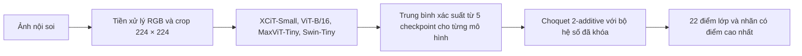

# GastroVision AI

**Phân loại 22 lớp ảnh nội soi tiêu hóa bằng RIA2C · Streamlit · PyTorch**

GastroVision AI là ứng dụng nghiên cứu của khóa luận KLTN 36. Ứng dụng hợp nhất dự đoán của bốn mô hình thị giác bằng tích phân Choquet 2-additive, hiển thị vùng ảnh ảnh hưởng đến dự đoán của từng mô hình qua Grad-CAM và cho phép xem từng hạng đóng góp vào điểm hợp nhất.

[Chạy trên máy cá nhân](#chạy-trên-máy-cá-nhân) · [Dữ liệu GastroVision](#dữ-liệu-gastrovision) · [Kết quả khóa luận](#kết-quả-khóa-luận) · [Cách RIA2C tính điểm](#cách-ria2c-tính-điểm)

> [!IMPORTANT]
> Ứng dụng dành cho nghiên cứu và trình diễn kỹ thuật. Mô hình chưa được thẩm định lâm sàng. Chỉ tải lên ảnh bạn có quyền sử dụng và đã loại bỏ thông tin định danh.

## Tính năng

| Khu vực | Nội dung |
| --- | --- |
| **Một ảnh** | Tải JPG, JPEG hoặc PNG để xem lớp dự đoán, các lớp cạnh tranh và đầu ra của từng mô hình. |
| **Hàng loạt** | Phân loại nhiều ảnh hoặc tệp ZIP, báo lỗi theo từng ảnh và xuất CSV. Có thể nạp nhãn thật để tính Accuracy trên các ảnh có nhãn và suy luận thành công. |
| **Grad-CAM** | Tạo bản đồ nhiệt riêng cho từng mô hình. Chọn lớp đích chung theo RIA2C hoặc lớp dự đoán riêng của mỗi mô hình. |
| **Cơ chế RIA2C** | Xem 22 điểm Choquet, phân rã 4 hạng đơn và 6 hạng cặp cho lớp được chọn, hoặc xem tầm quan trọng Shapley của capacity. |
| **Nghiên cứu & hướng dẫn** | Tra cứu ánh xạ 22 lớp và cách đọc kết quả. |

## Cách RIA2C tính điểm



Với mỗi lớp, RIA2C lấy tổng **bốn hạng đơn** và **sáu hạng cặp**. Hạng đơn bằng xác suất nhân hệ số của mô hình. Hạng cặp bằng xác suất nhỏ hơn của hai mô hình nhân hệ số của cặp đó. Bộ hệ số Möbius được học trên tập Development và được cố định khi chạy ứng dụng. Điểm Choquet dùng để xếp hạng lớp và chưa được xác nhận hiệu chuẩn.

Grad-CAM được tính riêng cho từng mô hình và lớp đích. Phân rã Möbius cho biết đóng góp vào điểm của một ảnh cụ thể. Chỉ số Shapley mô tả tầm quan trọng của các mô hình ở cấp capacity.

## Dữ liệu GastroVision

Tải dữ liệu gốc tại [kho GastroVision trên OSF](https://osf.io/84e7f/). Thông tin phát hành, siêu dữ liệu và phân chia do tác giả cung cấp được dẫn tại [trang dự án GastroVision](https://github.com/DebeshJha/GastroVision) và [Simula Datasets](https://datasets.simula.no/gastrovision/).

Khóa luận dùng cấu hình **22 lớp**, gồm **6.338 ảnh Development** sau rà soát ảnh trùng hoặc gần trùng và **1.586 ảnh Official Test**. Development được chia năm fold bằng StratifiedGroupKFold theo nhóm ảnh liên quan. Dữ liệu ảnh được tải riêng từ nguồn trên. Thứ tự các nhãn của ứng dụng nằm trong [manifest](ria2c_app_manifest.json).

## Kết quả khóa luận

Hai phương pháp dưới đây dùng cùng bốn mô hình cơ sở và cùng **1.586 ảnh Official Test**.

| Phương pháp | Accuracy | Macro-F1 | MCC |
| --- | ---: | ---: | ---: |
| Soft Voting | 0,8525 | 0,6906 | 0,8350 |
| RIA2C | 0,8544 | 0,6917 | 0,8371 |

Chênh lệch Macro-F1 từ số gốc là **+0,001154**. Khoảng tin cậy 95% bootstrap ghép cặp theo ảnh (20.000 lượt lấy mẫu lại) là **[0; 0,002688]**, chứa 0. Kết quả chưa xác lập ưu thế thống kê của RIA2C so với Soft Voting trong phép đối chứng này.

Nguồn số liệu là báo cáo khóa luận KLTN 36, Bảng 4.5 và Mục 4.3.1. Đây là kết quả đánh giá trên tập khóa luận, với khả năng khái quát lâm sàng và tách biệt ở cấp bệnh nhân chưa được xác nhận.

## Chạy trên máy cá nhân

Cần **Python 3.11**, Git và quyền truy cập **20 checkpoint gốc**. Các checkpoint có dung lượng khoảng **3,36 GB** và được cấp riêng. Manifest ghi tên tệp, kích thước và SHA-256 để ứng dụng kiểm tra trước khi nạp.

### Cài đặt trên Windows với CPU

```powershell
git clone https://github.com/npd20052405-rgb/GastroVision-RIA2C-Streamlit.git
cd GastroVision-RIA2C-Streamlit
py -3.11 -m venv .venv
.\.venv\Scripts\python.exe -m pip install -r requirements.txt
$env:RIA2C_MODEL_DIR = 'D:\models\ria2c'
.\.venv\Scripts\python.exe -m streamlit run streamlit_app.py
```

Thay đường dẫn ví dụ bằng thư mục chứa checkpoint, rồi mở [ứng dụng cục bộ tại cổng 8501](http://localhost:8501). Với môi trường CUDA 11.8 mới, dùng [requirements-cuda.txt](requirements-cuda.txt) trong môi trường Python riêng. Trên Linux hoặc macOS, tạo môi trường bằng `python3.11 -m venv .venv`, chạy bằng `.venv/bin/python` và đặt đường dẫn trọng số bằng `export RIA2C_MODEL_DIR=/path/to/checkpoints`.

### Dùng ứng dụng

1. Mở **Một ảnh** hoặc **Hàng loạt** và chọn tệp.
2. Chạy phân loại để xem nhãn, điểm và đầu ra của các mô hình cơ sở.
3. Mở **Grad-CAM** hoặc **Cơ chế RIA2C** để xem diễn giải của ảnh đã xử lý.

Tệp nhãn tùy chọn dùng CSV UTF-8. ID lớp hiển thị từ 1 đến 22 theo manifest. Với ảnh trùng tên tệp, dùng cột `file_id` từ CSV kết quả thay cho `filename`.

```csv
filename,class_id
anh_01.jpg,3
anh_02.jpg,19
```

<details>
<summary><strong>Docker và Streamlit Community Cloud</strong></summary>

Dockerfile dùng CPU và đọc checkpoint từ volume chỉ đọc.

```bash
docker build -t gastrovision-ria2c .
docker run --rm -p 7860:7860 -v /absolute/path/to/checkpoints:/models:ro gastrovision-ria2c
```

Mở `http://localhost:7860`. Với Streamlit Community Cloud, chọn Python 3.11 và tệp chạy `streamlit_app.py`. Người có quyền vào kho checkpoint riêng thiết lập thông tin Release và token chỉ đọc trong **Secrets** theo [tệp mẫu](.streamlit/secrets.example.toml). Sau khi mở ứng dụng, dùng nút tải và xác minh checkpoint. Tài nguyên và cache của Cloud phụ thuộc phiên triển khai.

</details>

## Các tệp chính

| Tệp | Vai trò |
| --- | --- |
| [streamlit_app.py](streamlit_app.py) | Giao diện, tiền xử lý, suy luận, Choquet và Grad-CAM. |
| [ria2c_app_manifest.json](ria2c_app_manifest.json) | Ánh xạ lớp, cấu hình mô hình, SHA-256 checkpoint và 10 hệ số Möbius. |
| [requirements.txt](requirements.txt) · [requirements-cuda.txt](requirements-cuda.txt) | Phụ thuộc cho CPU và CUDA 11.8. |
| [Dockerfile](Dockerfile) | Cấu hình chạy ứng dụng bằng Docker trên CPU. |

## Trích dẫn

Nguồn bộ dữ liệu: Jha và cộng sự (2023), *GastroVision: A Multi-class Endoscopy Image Dataset for Computer Aided Gastrointestinal Disease Detection*. Thông tin trích dẫn đầy đủ và BibTeX có tại [trang GastroVision của Simula](https://datasets.simula.no/gastrovision/).
